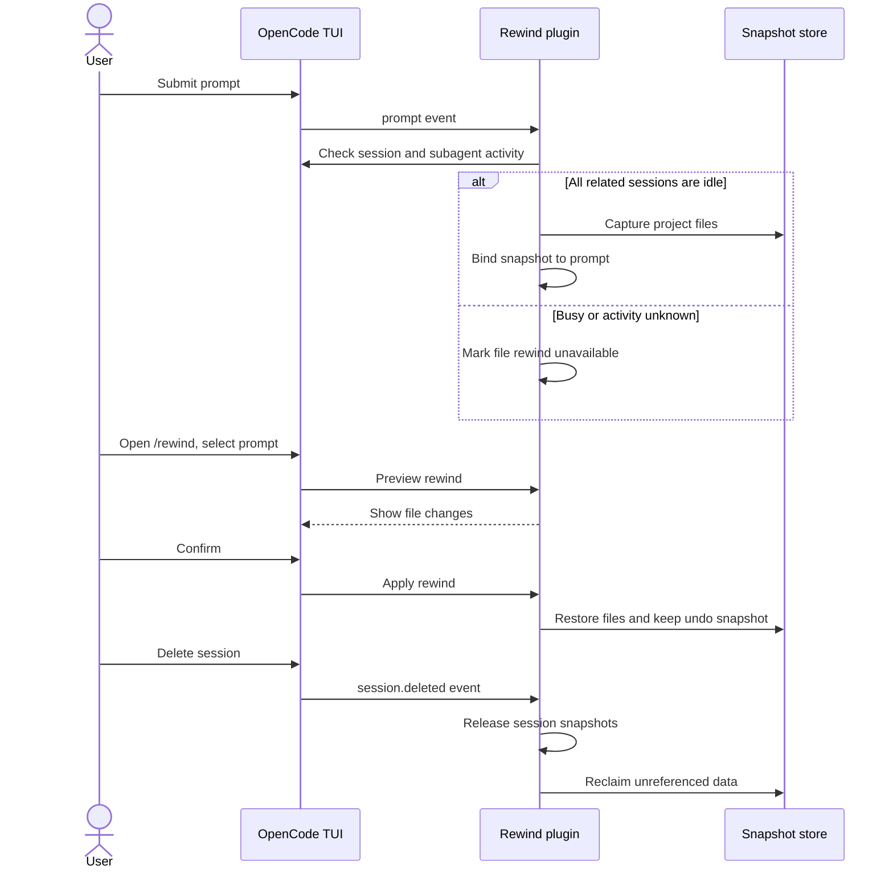

# OpenCode Rewind

Rewind a session's conversation and project files to an earlier prompt. File snapshots include edits from background subagents. Use `/rewind`; OpenCode's `/timeline` is unchanged.

## How it works



## Install

```sh
git clone https://github.com/ismailokta/opencode-rewind.git ~/.config/opencode/plugins/opencode-rewind
cd ~/.config/opencode/plugins/opencode-rewind
npm install --no-save --ignore-scripts
```

Add the plugin path to `plugins` in `~/.config/opencode/opencode.json` (or a project's `opencode.json`):

```json
{
  "plugins": ["/Users/you/.config/opencode/plugins/opencode-rewind"]
}
```

Restart OpenCode, then run `/rewind` in a session. Prompts marked `◆` have file snapshots; other prompts rewind the conversation only.

## Controls

- **Enter** — preview and rewind to the selected prompt
- **Ctrl+D** — delete its file snapshot
- **Ctrl+X** — clear snapshots for the session
- **Ctrl+Z** — undo a staged rewind
- **Ctrl+R** — recover files only

## Limits

- File snapshots are captured only when related sessions are observed idle; this is not a lock against concurrent writes.
- Restore covers non-ignored regular files under the active directory. It does not restore ignored files, symlinks, submodules, databases, or external side effects.
- Stop other writers before confirming a rewind. File conflict checks are best-effort, not atomic.
- Deleting a session removes its snapshots when the plugin is running. Git may take up to an hour to reclaim disk space.

## Tests

```sh
# Unit and lifecycle tests (uses disposable Git repositories)
npm test

# End-to-end rewind and undo with an isolated OpenCode server/TUI
python3 test/e2e-smoke.py --background --mock-model

# End-to-end session deletion and snapshot cleanup
python3 test/e2e-smoke.py --deletion --mock-model
```

Validated with OpenCode 2.2.7.
